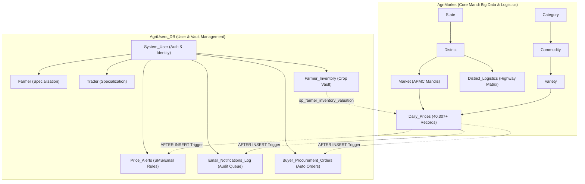

# 🌾 AgriMarket: Smart APMC Mandi Decision Support & Farmer Management System

[](https://www.python.org/)
[](https://www.mysql.com/)
[](https://streamlit.io/)
[](LICENSE)
[](https://github.com/sourabhguptabtech2025)

An enterprise-grade Agricultural Market Intelligence, Price Forecasting, and Farmer Storage Management Platform powered by **Python**, **Streamlit**, and a normalized **Dual-Database MySQL Architecture** (`AgriMarket` & `AgriUsers_DB`). The system processes **40,307 real wholesale market records** sourced from Agmarknet across 90 APMC mandis in Maharashtra.

---

## 🌟 Key Features

* **Two-Database Microservice-Style Architecture**:
  * `AgriMarket`: 40,000+ mandi auction records, dimensional hierarchies (State, District, APMC Market, Commodity, Variety), and highway logistics distance matrices.
  * `AgriUsers_DB`: User authentication (SHA-256 encrypted), EER Subclass specialization (`Farmer` vs. `Trader`), Farmer Storage Vault (`Farmer_Inventory`), automated price alert monitors, and email outbox audit queues.
* **🥦 Vegetables vs. 🍎 Fruits Split**:
  * Dedicated high-speed dashboards for Vegetables (*Onion, Tomato, Potato, Garlic, Carrot*) and Fruits (*Apple, Banana, Mango*).
  * Real-time benchmark retail price equivalents (₹ / kg) calculated dynamically from wholesale quintal prices.
* **📦 Farmer Crop Storage Vault & Valuation Engine**:
  * Tracks physical crop batches in on-farm cold rooms with production cultivation cost per quintal.
  * Evaluated in real time against live APMC auction hammer prices using the cross-database stored procedure `sp_farmer_inventory_valuation`.
  * Computes Net Profit/Loss, ROI %, and automated action advisories (`SELL NOW (PROFITABLE)`, `HOLD IN STORAGE`).
* **🚚 Trader Logistics Desk & True Landed Cost Calculator**:
  * Incorporates a 26-route highway distance matrix to Mumbai (Vashi Hub) and Pune (Market Yard Hub).
  * Computes True Landed Cost: $\text{Auction Price} + (\text{Distance} \times \text{Freight Rate}) + 1.05\%\text{ Mandi Cess}$.
* **⚡ Inter-District Arbitrage Radar**:
  * Discovers buy-low / sell-high spatial opportunities across districts on identical trading dates (e.g., buying Onion in Solapur at ₹450/Qtl and selling in Nagpur at ₹1,770/Qtl).
* **🔔 Automated Real-Time Triggers**:
  * Trigger `trg_after_price_insert_alert` monitors target breaches and queues HTML email alerts into `Email_Notifications_Log`.
  * Trigger `trg_buyer_auto_procurement_order` auto-generates 25-tonne purchase orders for traders during arrival market gluts.

---

## 🏗️ System Architecture



---

## 📂 Repository Structure

```text
sql_mandi/
├── README.md                           # Master Project Documentation & Quickstart
├── .gitignore                          # Excluded virtual environments and build cache
├── agri_market_etl.py                  # Standalone ETL pipeline script
├── Fruits/                             # Raw Agmarknet CSV datasets for Fruits
│   ├── Apple_arrival_price.csv
│   ├── Banana_arrvial_price.csv
│   └── Mango_arrival_price.csv
├── Vegetables/                         # Nested Agmarknet CSV datasets for Vegetables
│   ├── carrot/carrot_arrival_price.csv
│   ├── garlic/garlic_arrival_price.csv
│   ├── onion/onion_arrival_price.csv
│   ├── potato/potato_arrival_price.csv
│   └── tomato/tomato_arrival_price.csv
└── database_and_scripts/               # Core SQL codebase & Web Application
    ├── app.py                          # Full-featured Streamlit Web Application
    ├── COMPLETE_PROJECT_DATABASE_REPORT.md # Exhaustive technical reference & SQL report
    ├── schema_and_seed.sql             # 11-table master schema & seed data
    ├── advanced_sql_features.sql       # Views, functions, procedures, & triggers
    ├── setup_user_database.sql         # AgriUsers_DB database creation & migration
    ├── real_world_queries.sql          # 10 production-grade analytical SQL queries
    ├── ingest_agrimarket.py            # Automated Pandas-to-MySQL data ingestion
    ├── sql_features_guide.md           # Quick reference guide & Viva cheat-sheet
    └── run_app.bat                     # Windows 1-click batch launcher
```

---

## ⚡ Database Suite Quick Reference

### 1. Analytical Views
* `vw_mandi_complete_feed`: 7-table master feed joining daily prices, markets, districts, varieties, and intraday spreads.
* `vw_district_crop_summary`: Regional production summary aggregating cumulative tonnage and price averages per district.
* `vw_buyer_mandi_risk_index`: Statistical volatility index (`STDDEV_POP` / `AVG`) classifying mandis into risk categories.

### 2. Stored Functions
* `fn_price_spread_pct(min_p, max_p)`: Measures auction hammer dispersion.
* `fn_inflow_status(tonnes)`: Categorizes arrival supply tiers (`Heavy Glut`, `Moderate Supply`, `Low Supply`).
* `fn_calculate_landed_cost(modal_p, dist_km, freight_rate, cess_pct)`: True landed cost at terminal warehouse.
* `fn_quality_discount_ratio(variety_modal, benchmark_modal)`: Computes variety quality premiums/discounts.

### 3. Stored Procedures
* `CALL sp_find_best_mandis('Onion', '2026-01-01', '2026-10-10', 5);`
* `CALL sp_buyer_bulk_procurement_plan('Tomato', 50.00, 'Mumbai (Vashi Hub)');`
* `CALL sp_buyer_arbitrage_radar('Onion', '2026-05-15', 400.00);`
* `CALL AgriUsers_DB.sp_farmer_inventory_valuation(5);`
* `CALL AgriUsers_DB.sp_check_user_alerts(1);`

---

## 🚀 Getting Started

### Prerequisites
* **Python 3.10+**
* **MySQL Server 8.0+ / 26.x** running on `localhost:3306`

### 1. Database Setup
Log into your MySQL terminal and run the SQL migration scripts in order:
```bash
mysql -u root -p < database_and_scripts/schema_and_seed.sql
mysql -u root -p < database_and_scripts/advanced_sql_features.sql
mysql -u root -p < database_and_scripts/setup_user_database.sql
```

### 2. Install Dependencies
```bash
pip install streamlit pandas mysql-connector-python plotly altair
```

### 3. Launch Application
```bash
cd database_and_scripts
python -m streamlit run app.py
```
Open your browser at **`http://localhost:8501`**.

---

## 👨‍💻 Author
**Sourabh Gupta**  
* GitHub: [@sourabhguptabtech2025](https://github.com/sourabhguptabtech2025)  
* Email: `sourabhgupta16062007@gmail.com`
