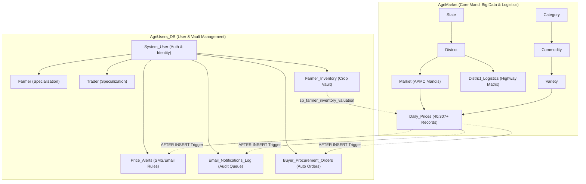

# AgriMarket & AgriUsers Enterprise Database System: Complete Technical & SQL Report

**Project Name:** AgriMarket Smart Mandi Decision Support & Farmer Management System  
**Databases:** `AgriMarket` & `AgriUsers_DB`  
**Host:** `localhost:3306` | **Database Dialect:** MySQL 8.x / 26.x  
**Web Application:** Python Streamlit (`app.py` on `localhost:8501`)  
**Output Directory:** `C:\Users\HP\Documents\sql_mandi\database_and_scripts`

---

## Executive Summary & System Architecture

This project is an end-to-end, enterprise-grade Agricultural Market Intelligence & Decision Support Platform. The system is architected into two decoupled, specialized relational databases:



1. **`AgriMarket` Database (Mandi Big Data & Logistics)**:
   - Contains **40,307 real trading records** from Agmarknet across Maharashtra.
   - Master dimensional tables: 1 State, 13 Districts, 90 APMC Mandis, 2 Categories (Vegetables & Fruits), 8 Commodities, and 24 Varieties.
   - Contains highway logistics routes, analytical views, stored procedures, and price evaluation functions.

2. **`AgriUsers_DB` Database (User Authentication, Crop Vault & Automation)**:
   - Handles secure email/password authentication (passwords hashed using SHA-256).
   - EER Subclass specialization for **Farmers** (farm acreage, primary crops) and **Traders** (APMC license, GST, firm names).
   - Manages the **Farmer Storage Vault** (`Farmer_Inventory`) for tracking harvest batches, production costs, and real-time market gains.
   - Houses notification queues (`Email_Notifications_Log`) and automated trade triggers (`Buyer_Procurement_Orders`).

---

## Part 1: Schema & Table Directory

### A. Tables in `AgriMarket`

| Table Name | Primary Key | Foreign Keys | Row Count | Purpose & Description |
| :--- | :--- | :--- | :--- | :--- |
| **`State`** | `StateID` | None | 1 | Master state directory (`Maharashtra`). |
| **`District`** | `DistrictID` | `StateID` | 13 | Top agricultural production districts (Nashik, Pune, Ahmednagar, Solapur, Nagpur, etc.). |
| **`Market`** | `MarketID` | `DistrictID` | 90 | APMC wholesale mandis where crop auctions take place. |
| **`Category`** | `CategoryID` | None | 2 | Macro grouping: `Vegetables` and `Fruits`. |
| **`Commodity`** | `CommodityID` | `CategoryID` | 8 | Crops tracked: Onion, Tomato, Potato, Garlic, Carrot, Apple, Banana, Mango. |
| **`Variety`** | `VarietyID` | `CommodityID` | 24 | Sub-varieties (e.g., Red Onion, White Onion, Hybrid Tomato, Local Potato, etc.). |
| **`Daily_Prices`** | `PriceID` | `MarketID`, `VarietyID` | 40,307 | Historical time-series mandi auction records (`RecordDate`, `MinPrice`, `MaxPrice`, `ModalPrice`, `ArrivalTonnes`, `Grade`). |
| **`District_Logistics`** | `LogisticsID` | `OriginDistrictID` | 26 | Highway route matrix: distances (km) and freight costs (₹/km/Qtl) from every district to Mumbai (Vashi Hub) and Pune (Market Yard Hub). |

### B. Tables in `AgriUsers_DB`

| Table Name | Primary Key | Foreign Keys | Purpose & Description |
| :--- | :--- | :--- | :--- |
| **`System_User`** | `UserID` | None | User directory with Name, Phone, Email, SHA-256 password hash, UserType (`Farmer`, `Trader`, `Admin`). |
| **`Farmer`** | `UserID` | `UserID` -> `System_User` | EER specialization storing farm size in acres, primary crop, and village. |
| **`Trader`** | `UserID` | `UserID` -> `System_User` | EER specialization storing APMC license numbers, trading company name, and GST number. |
| **`Farmer_Inventory`** | `InventoryID` | `FarmerUserID` | Crop storage vault: tracks stored harvest batches, cultivation cost per quintal, harvest dates, and storage status (`IN_STORAGE`, `READY_TO_SELL`, `SOLD`). |
| **`Price_Alerts`** | `AlertID` | `UserID` | Real-time threshold monitoring rules (`ABOVE` / `BELOW` target price). |
| **`Email_Notifications_Log`** | `NotificationID` | `UserID` | Outbox audit log capturing automated email alert notifications. |
| **`Buyer_Procurement_Orders`**| `OrderID` | `BuyerUserID` | Automated 25-tonne purchase orders triggered when wholesale prices fall below buyer thresholds. |

---

## Part 2: Database Views (Master Feeds & Risk Analytics)

### View 1: `vw_mandi_complete_feed`

#### 1. Business Purpose
Eliminates complex 7-table JOINs in backend code. Combines raw prices, mandi geographical hierarchy, commodity hierarchies, and computed intraday volatility spreads into a unified view for dashboards.

#### 2. Full SQL Creation Query
```sql
CREATE OR REPLACE VIEW vw_mandi_complete_feed AS
SELECT 
    p.PriceID,
    p.RecordDate,
    s.StateName,
    d.DistrictName,
    m.MarketName,
    cat.CategoryName,
    c.CommodityName,
    v.VarietyName,
    p.Grade,
    p.MinPrice,
    p.MaxPrice,
    p.ModalPrice,
    p.ArrivalTonnes,
    ROUND(((p.MaxPrice - p.MinPrice) / NULLIF(p.MinPrice, 0)) * 100, 2) AS IntradaySpreadPct
FROM Daily_Prices p
JOIN Market m ON p.MarketID = m.MarketID
JOIN District d ON m.DistrictID = d.DistrictID
JOIN State s ON d.StateID = s.StateID
JOIN Variety v ON p.VarietyID = v.VarietyID
JOIN Commodity c ON v.CommodityID = c.CommodityID
JOIN Category cat ON c.CategoryID = cat.CategoryID;
```

#### 3. How to Execute / Test
```sql
SELECT * FROM vw_mandi_complete_feed 
WHERE CommodityName = 'Onion' 
ORDER BY RecordDate DESC 
LIMIT 5;
```

---

### View 2: `vw_district_crop_summary`

#### 1. Business Purpose
Serves agricultural researchers, bank credit underwriters, and supply chain aggregators. Aggregates regional trading volume, cumulative tonnage, average pricing, and peak prices across districts.

#### 2. Full SQL Creation Query
```sql
CREATE OR REPLACE VIEW vw_district_crop_summary AS
SELECT 
    d.DistrictName,
    cat.CategoryName,
    c.CommodityName,
    COUNT(p.PriceID) AS TotalTradingRecords,
    ROUND(SUM(p.ArrivalTonnes), 2) AS TotalArrivalTonnes,
    ROUND(AVG(p.ModalPrice), 2) AS AvgModalPrice,
    MAX(p.MaxPrice) AS HighestMaxPrice,
    MIN(p.MinPrice) AS LowestMinPrice,
    ROUND(AVG(((p.MaxPrice - p.MinPrice) / NULLIF(p.MinPrice, 0)) * 100), 2) AS AvgIntradaySpreadPct
FROM Daily_Prices p
JOIN Market m ON p.MarketID = m.MarketID
JOIN District d ON m.DistrictID = d.DistrictID
JOIN Variety v ON p.VarietyID = v.VarietyID
JOIN Commodity c ON v.CommodityID = c.CommodityID
JOIN Category cat ON c.CategoryID = cat.CategoryID
GROUP BY d.DistrictName, cat.CategoryName, c.CommodityName;
```

#### 3. How to Execute / Test
```sql
SELECT * FROM vw_district_crop_summary 
WHERE CommodityName = 'Tomato' 
ORDER BY TotalArrivalTonnes DESC;
```

---

### View 3: `vw_buyer_mandi_risk_index`

#### 1. Business Purpose
Assesses wholesale price stability for food processors (e.g., tomato paste or potato chip manufacturers). Mandis with price swings $>25\%$ are rated **HIGH VOLATILITY (RISKY)**, preventing buyers from entering erratic spot contracts.

#### 2. Mathematical Logic
$$\text{VolatilityPct} = \frac{\text{STDDEV\_POP}(\text{ModalPrice})}{\text{AVG}(\text{ModalPrice})} \times 100$$

$$\text{ProcurementRiskRating} = \begin{cases} 
\text{'HIGH VOLATILITY (RISKY)'} & \text{if VolatilityPct} \ge 25\% \\
\text{'MODERATE RISK'} & \text{if VolatilityPct} \ge 12\% \\
\text{'STABLE PRICING (SAFE CONTRACTS)'} & \text{otherwise}
\end{cases}$$

#### 3. Full SQL Creation Query
```sql
CREATE OR REPLACE VIEW vw_buyer_mandi_risk_index AS
SELECT 
    d.DistrictName,
    m.MarketName,
    c.CommodityName,
    COUNT(p.PriceID) AS TotalTradingDays,
    ROUND(AVG(p.ModalPrice), 2) AS AvgModalPrice,
    ROUND(STDDEV_POP(p.ModalPrice), 2) AS PriceStdDev,
    ROUND((STDDEV_POP(p.ModalPrice) / NULLIF(AVG(p.ModalPrice), 0)) * 100, 2) AS VolatilityPct,
    ROUND(AVG(((p.MaxPrice - p.MinPrice) / NULLIF(p.MinPrice, 0)) * 100), 2) AS AvgIntradaySpreadPct,
    CASE 
        WHEN (STDDEV_POP(p.ModalPrice) / NULLIF(AVG(p.ModalPrice), 0)) * 100 >= 25.0 THEN 'HIGH VOLATILITY (RISKY)'
        WHEN (STDDEV_POP(p.ModalPrice) / NULLIF(AVG(p.ModalPrice), 0)) * 100 >= 12.0 THEN 'MODERATE RISK'
        ELSE 'STABLE PRICING (SAFE CONTRACTS)'
    END AS ProcurementRiskRating
FROM Daily_Prices p
JOIN Market m ON p.MarketID = m.MarketID
JOIN District d ON m.DistrictID = d.DistrictID
JOIN Variety v ON p.VarietyID = v.VarietyID
JOIN Commodity c ON v.CommodityID = c.CommodityID
GROUP BY d.DistrictName, m.MarketName, c.CommodityName
HAVING COUNT(p.PriceID) >= 10;
```

#### 4. How to Execute / Test
```sql
SELECT * FROM vw_buyer_mandi_risk_index 
WHERE ProcurementRiskRating = 'STABLE PRICING (SAFE CONTRACTS)' 
LIMIT 5;
```

---

## Part 3: Stored Functions (Math Engine)

All stored functions live in `AgriMarket` and encapsulate mathematical computations:

### Function 1: `fn_price_spread_pct`
* **Purpose:** Calculates intraday auction price spread percentage between minimum bid and maximum hammer price.
* **Full SQL Code:**
  ```sql
  DROP FUNCTION IF EXISTS fn_price_spread_pct;
  DELIMITER //
  CREATE FUNCTION fn_price_spread_pct(
      min_p DECIMAL(10,2),
      max_p DECIMAL(10,2)
  ) 
  RETURNS DECIMAL(6,2)
  DETERMINISTIC
  NO SQL
  BEGIN
      IF min_p IS NULL OR max_p IS NULL OR min_p <= 0 THEN
          RETURN 0.00;
      END IF;
      RETURN LEAST(ROUND(((max_p - min_p) / min_p) * 100, 2), 9999.99);
  END //
  DELIMITER ;
  ```
* **Test Query:**
  ```sql
  SELECT fn_price_spread_pct(1500.00, 2100.00) AS SpreadPct; -- Returns: 40.00%
  ```

---

### Function 2: `fn_inflow_status`
* **Purpose:** Categorizes physical crop arrival tonnage into economic liquidity tiers (`Heavy Glut`, `Moderate Supply`, `Low Supply`).
* **Full SQL Code:**
  ```sql
  DROP FUNCTION IF EXISTS fn_inflow_status;
  DELIMITER //
  CREATE FUNCTION fn_inflow_status(
      tonnes DECIMAL(12,2)
  ) 
  RETURNS VARCHAR(30)
  DETERMINISTIC
  NO SQL
  BEGIN
      IF tonnes IS NULL OR tonnes = 0 THEN
          RETURN 'No Trading Activity';
      ELSEIF tonnes >= 1000.00 THEN
          RETURN 'Heavy Glut (>=1000T)';
      ELSEIF tonnes >= 100.00 THEN
          RETURN 'Moderate Supply (100-999T)';
      ELSE
          RETURN 'Low Supply (<100T)';
      END IF;
  END //
  DELIMITER ;
  ```
* **Test Query:**
  ```sql
  SELECT fn_inflow_status(1250.00) AS Tier; -- Returns: 'Heavy Glut (>=1000T)'
  ```

---

### Function 3: `fn_calculate_landed_cost`
* **Purpose:** Computes the true delivered cost per quintal at a buyer's terminal consumption warehouse:
  $$\text{LandedCost} = \text{MandiModalPrice} + (\text{DistanceKm} \times \text{FreightRate}) + \left(\frac{\text{MandiModalPrice} \times \text{CessPct}}{100}\right)$$
* **Full SQL Code:**
  ```sql
  DROP FUNCTION IF EXISTS fn_calculate_landed_cost;
  DELIMITER //
  CREATE FUNCTION fn_calculate_landed_cost(
      modal_price DECIMAL(10,2),
      distance_km DECIMAL(6,2),
      freight_rate DECIMAL(5,2),
      mandi_cess_pct DECIMAL(4,2)
  ) 
  RETURNS DECIMAL(10,2)
  DETERMINISTIC
  NO SQL
  BEGIN
      DECLARE transport_cost DECIMAL(10,2);
      DECLARE cess_cost DECIMAL(10,2);
      
      SET transport_cost = COALESCE(distance_km, 0) * COALESCE(freight_rate, 2.50);
      SET cess_cost = (COALESCE(modal_price, 0) * COALESCE(mandi_cess_pct, 1.05)) / 100.0;
      
      RETURN ROUND(COALESCE(modal_price, 0) + transport_cost + cess_cost, 2);
  END //
  DELIMITER ;
  ```
* **Test Query:**
  ```sql
  SELECT fn_calculate_landed_cost(2500.00, 210.00, 2.40, 1.05) AS LandedCostPerQtl; -- Returns: ₹ 3030.25
  ```

---

### Function 4: `fn_quality_discount_ratio`
* **Purpose:** Measures the quality premium (+) or discount (-) of a specific variety compared to the commodity baseline average price.
* **Full SQL Code:**
  ```sql
  DROP FUNCTION IF EXISTS fn_quality_discount_ratio;
  DELIMITER //
  CREATE FUNCTION fn_quality_discount_ratio(
      variety_modal DECIMAL(10,2),
      benchmark_modal DECIMAL(10,2)
  ) 
  RETURNS DECIMAL(6,2)
  DETERMINISTIC
  NO SQL
  BEGIN
      IF benchmark_modal IS NULL OR benchmark_modal <= 0 OR variety_modal IS NULL THEN
          RETURN 0.00;
      END IF;
      RETURN ROUND(((variety_modal - benchmark_modal) / benchmark_modal) * 100, 2);
  END //
  DELIMITER ;
  ```
* **Test Query:**
  ```sql
  SELECT fn_quality_discount_ratio(2800.00, 2500.00) AS PremiumPct; -- Returns: +12.00%
  ```

---

## Part 4: Stored Procedures (Decision Support System)

### Procedure 1: `sp_find_best_mandis` (In `AgriMarket`)
* **Target User:** **Farmers & Farmer Producer Organizations (FPOs)**
* **Inputs:** `in_commodity VARCHAR(100)`, `in_start_date DATE`, `in_end_date DATE`, `in_limit INT`
* **Purpose:** Ranks APMC mandis by highest average price and peak auction price, filtering out illiquid mandis.
* **Full SQL Code:**
  ```sql
  DROP PROCEDURE IF EXISTS sp_find_best_mandis;
  DELIMITER //
  CREATE PROCEDURE sp_find_best_mandis(
      IN in_commodity VARCHAR(100),
      IN in_start_date DATE,
      IN in_end_date DATE,
      IN in_limit INT
  )
  BEGIN
      DECLARE v_limit INT DEFAULT 10;
      IF in_limit IS NOT NULL AND in_limit > 0 THEN
          SET v_limit = in_limit;
      END IF;

      SELECT 
          m.MarketName,
          d.DistrictName,
          ROUND(AVG(p.ModalPrice), 2) AS AvgModalPrice,
          MAX(p.MaxPrice) AS PeakMaxPrice,
          MIN(p.MinPrice) AS LowestMinPrice,
          ROUND(SUM(p.ArrivalTonnes), 2) AS TotalArrivalTonnes,
          COUNT(p.PriceID) AS TradingDaysCount,
          ROUND(AVG(fn_price_spread_pct(p.MinPrice, p.MaxPrice)), 2) AS AvgPriceSpreadPct
      FROM Daily_Prices p
      JOIN Market m ON p.MarketID = m.MarketID
      JOIN District d ON m.DistrictID = d.DistrictID
      JOIN Variety v ON p.VarietyID = v.VarietyID
      JOIN Commodity c ON v.CommodityID = c.CommodityID
      WHERE c.CommodityName = in_commodity
        AND (in_start_date IS NULL OR p.RecordDate >= in_start_date)
        AND (in_end_date IS NULL OR p.RecordDate <= in_end_date)
      GROUP BY m.MarketName, d.DistrictName
      HAVING COUNT(p.PriceID) >= 3
      ORDER BY AvgModalPrice DESC, PeakMaxPrice DESC
      LIMIT v_limit;
  END //
  DELIMITER ;
  ```
* **Execution Command:**
  ```sql
  CALL AgriMarket.sp_find_best_mandis('Onion', '2026-01-01', '2026-10-10', 5);
  ```

---

### Procedure 2: `sp_buyer_bulk_procurement_plan` (In `AgriMarket`)
* **Target User:** **Wholesale Buyers, Supermarket Procurement Desks, Exporters**
* **Inputs:** `in_commodity VARCHAR(100)`, `in_required_tonnes DECIMAL(12,2)`, `in_hub_name VARCHAR(100)`
* **Purpose:** Calculates true landed costs from every production district to a central hub (Mumbai or Pune), factoring in freight and APMC cess.
* **Full SQL Code:**
  ```sql
  DROP PROCEDURE IF EXISTS sp_buyer_bulk_procurement_plan;
  DELIMITER //
  CREATE PROCEDURE sp_buyer_bulk_procurement_plan(
      IN in_commodity VARCHAR(100),
      IN in_required_tonnes DECIMAL(12,2),
      IN in_hub_name VARCHAR(100)
  )
  BEGIN
      WITH LatestMarketPrices AS (
          SELECT 
              p.MarketID,
              p.VarietyID,
              p.ModalPrice,
              p.ArrivalTonnes,
              p.RecordDate,
              ROW_NUMBER() OVER(PARTITION BY p.MarketID ORDER BY p.RecordDate DESC, p.PriceID DESC) as rn
          FROM Daily_Prices p
          JOIN Variety v ON p.VarietyID = v.VarietyID
          JOIN Commodity c ON v.CommodityID = c.CommodityID
          WHERE c.CommodityName = in_commodity
      )
      SELECT 
          m.MarketName,
          d.DistrictName,
          c.CommodityName,
          lp.ModalPrice AS MandiModalPricePerQtl,
          dl.DestHubName,
          dl.DistanceKm AS TransportDistanceKm,
          dl.FreightPerKmQuintal AS FreightRatePerKmQtl,
          fn_calculate_landed_cost(lp.ModalPrice, dl.DistanceKm, dl.FreightPerKmQuintal, 1.05) AS LandedCostPerQuintal,
          lp.ArrivalTonnes AS MandiDailyArrivalTonnes,
          CASE 
              WHEN lp.ArrivalTonnes >= in_required_tonnes THEN 'SUFFICIENT SUPPLY'
              WHEN lp.ArrivalTonnes >= (in_required_tonnes * 0.50) THEN 'PARTIAL SUPPLY (SPLIT ORDER)'
              ELSE 'LOW LIQUIDITY (HIGH SLIPPAGE)'
          END AS SupplyFeasibility,
          ROUND(fn_calculate_landed_cost(lp.ModalPrice, dl.DistanceKm, dl.FreightPerKmQuintal, 1.05) * (in_required_tonnes * 10), 2) AS TotalProcurementCostINR,
          lp.RecordDate AS PriceAsOfDate
      FROM LatestMarketPrices lp
      JOIN Market m ON lp.MarketID = m.MarketID
      JOIN District d ON m.DistrictID = d.DistrictID
      JOIN Variety v ON lp.VarietyID = v.VarietyID
      JOIN Commodity c ON v.CommodityID = c.CommodityID
      LEFT JOIN District_Logistics dl ON d.DistrictID = dl.OriginDistrictID AND dl.DestHubName = in_hub_name
      WHERE lp.rn = 1
      ORDER BY LandedCostPerQuintal ASC;
  END //
  DELIMITER ;
  ```
* **Execution Command:**
  ```sql
  CALL AgriMarket.sp_buyer_bulk_procurement_plan('Tomato', 100.00, 'Mumbai (Vashi Hub)');
  ```

---

### Procedure 3: `sp_buyer_arbitrage_radar` (In `AgriMarket`)
* **Target User:** **Inter-District Commission Traders & Truckers**
* **Inputs:** `in_commodity VARCHAR(100)`, `in_date DATE`, `in_min_margin DECIMAL(10,2)`
* **Purpose:** Executes an intraday self-join on `Daily_Prices` to locate geographic price spreads where buying in district A and selling in district B generates huge margins.
* **Full SQL Code:**
  ```sql
  DROP PROCEDURE IF EXISTS sp_buyer_arbitrage_radar;
  DELIMITER //
  CREATE PROCEDURE sp_buyer_arbitrage_radar(
      IN in_commodity VARCHAR(100),
      IN in_date DATE,
      IN in_min_margin DECIMAL(10,2)
  )
  BEGIN
      SELECT 
          p_low.RecordDate,
          c.CommodityName,
          d_low.DistrictName AS SourcingDistrict,
          m_low.MarketName AS BuyMandi,
          p_low.ModalPrice AS BuyPricePerQtl,
          p_low.ArrivalTonnes AS BuyMandiAvailableTonnes,
          d_high.DistrictName AS DestinationDistrict,
          m_high.MarketName AS SellMandi,
          p_high.ModalPrice AS SellPricePerQtl,
          ROUND(p_high.ModalPrice - p_low.ModalPrice, 2) AS GrossArbitrageSpreadPerQtl,
          ROUND(((p_high.ModalPrice - p_low.ModalPrice) / p_low.ModalPrice) * 100, 2) AS ReturnOnCapitalPct
      FROM Daily_Prices p_low
      JOIN Market m_low ON p_low.MarketID = m_low.MarketID
      JOIN District d_low ON m_low.DistrictID = d_low.DistrictID
      JOIN Variety v ON p_low.VarietyID = v.VarietyID
      JOIN Commodity c ON v.CommodityID = c.CommodityID
      JOIN Daily_Prices p_high ON p_high.RecordDate = p_low.RecordDate AND p_high.VarietyID = p_low.VarietyID
      JOIN Market m_high ON p_high.MarketID = m_high.MarketID
      JOIN District d_high ON m_high.DistrictID = d_high.DistrictID
      WHERE c.CommodityName = in_commodity
        AND p_low.RecordDate = in_date
        AND d_low.DistrictID != d_high.DistrictID
        AND (p_high.ModalPrice - p_low.ModalPrice) >= in_min_margin
      ORDER BY GrossArbitrageSpreadPerQtl DESC;
  END //
  DELIMITER ;
  ```
* **Execution Command:**
  ```sql
  CALL AgriMarket.sp_buyer_arbitrage_radar('Onion', '2026-05-15', 400.00);
  ```

---

### Procedure 4: `sp_farmer_inventory_valuation` (In `AgriUsers_DB`)
* **Target User:** **Farmers (Crop Storage Vault)**
* **Inputs:** `in_farmer_id INT`
* **Purpose:** Cross-database procedure connecting stored batches in `AgriUsers_DB.Farmer_Inventory` with live prices in `AgriMarket.Daily_Prices`. Computes Total Investment, Current Market Valuation, Net Profit/Loss, ROI %, and gives clear recommendations (`SELL NOW (PROFITABLE)`, `HOLD IN STORAGE`).
* **Full SQL Code:**
  ```sql
  DROP PROCEDURE IF EXISTS AgriUsers_DB.sp_farmer_inventory_valuation;
  DELIMITER //
  CREATE PROCEDURE AgriUsers_DB.sp_farmer_inventory_valuation(
      IN in_farmer_id INT
  )
  BEGIN
      WITH LatestVarietyPrices AS (
          SELECT 
              p.VarietyID,
              p.ModalPrice,
              p.RecordDate,
              m.MarketName,
              d.DistrictName,
              ROW_NUMBER() OVER(PARTITION BY p.VarietyID ORDER BY p.RecordDate DESC, p.PriceID DESC) as rn
          FROM AgriMarket.Daily_Prices p
          JOIN AgriMarket.Market m ON p.MarketID = m.MarketID
          JOIN AgriMarket.District d ON m.DistrictID = d.DistrictID
      ),
      LatestCommodityPrices AS (
          SELECT 
              v.CommodityID,
              p.ModalPrice,
              p.RecordDate,
              m.MarketName,
              d.DistrictName,
              ROW_NUMBER() OVER(PARTITION BY v.CommodityID ORDER BY p.RecordDate DESC, p.PriceID DESC) as rn
          FROM AgriMarket.Daily_Prices p
          JOIN AgriMarket.Variety v ON p.VarietyID = v.VarietyID
          JOIN AgriMarket.Market m ON p.MarketID = m.MarketID
          JOIN AgriMarket.District d ON m.DistrictID = d.DistrictID
      )
      SELECT 
          fi.InventoryID,
          fi.FarmerUserID,
          u.Name AS FarmerName,
          c.CommodityName,
          v.VarietyName,
          fi.QuantityQuintals,
          fi.CultivationCostPerQtl,
          ROUND(fi.QuantityQuintals * fi.CultivationCostPerQtl, 2) AS TotalInvestmentCost,
          COALESCE(lv.ModalPrice, lc.ModalPrice, fi.CultivationCostPerQtl) AS CurrentMandiPricePerQtl,
          COALESCE(lv.RecordDate, lc.RecordDate) AS PriceDate,
          COALESCE(lv.MarketName, lc.MarketName) AS BenchmarkMandi,
          ROUND(fi.QuantityQuintals * COALESCE(lv.ModalPrice, lc.ModalPrice, fi.CultivationCostPerQtl), 2) AS CurrentMarketValuation,
          ROUND((fi.QuantityQuintals * COALESCE(lv.ModalPrice, lc.ModalPrice, fi.CultivationCostPerQtl)) - 
                (fi.QuantityQuintals * fi.CultivationCostPerQtl), 2) AS EstimatedNetProfitLossINR,
          ROUND(((COALESCE(lv.ModalPrice, lc.ModalPrice, fi.CultivationCostPerQtl) - fi.CultivationCostPerQtl) / 
                NULLIF(fi.CultivationCostPerQtl, 0)) * 100.0, 2) AS ROIPercent,
          fi.HarvestDate,
          fi.StorageStatus,
          fi.StorageLocation,
          CASE 
              WHEN COALESCE(lv.ModalPrice, lc.ModalPrice, fi.CultivationCostPerQtl) >= (fi.CultivationCostPerQtl * 1.20) 
                  THEN 'SELL NOW (PROFITABLE)'
              WHEN COALESCE(lv.ModalPrice, lc.ModalPrice, fi.CultivationCostPerQtl) >= fi.CultivationCostPerQtl 
                  THEN 'MARGINAL PROFIT (HOLD OR SELL)'
              ELSE 'HOLD IN STORAGE (UNDER COST)'
          END AS SalesRecommendation
      FROM AgriUsers_DB.Farmer_Inventory fi
      JOIN AgriUsers_DB.System_User u ON fi.FarmerUserID = u.UserID
      JOIN AgriMarket.Variety v ON fi.VarietyID = v.VarietyID
      JOIN AgriMarket.Commodity c ON v.CommodityID = c.CommodityID
      LEFT JOIN LatestVarietyPrices lv ON v.VarietyID = lv.VarietyID AND lv.rn = 1
      LEFT JOIN LatestCommodityPrices lc ON c.CommodityID = lc.CommodityID AND lc.rn = 1
      WHERE fi.FarmerUserID = in_farmer_id
      ORDER BY fi.HarvestDate DESC;
  END //
  DELIMITER ;
  ```
* **Execution Command:**
  ```sql
  CALL AgriUsers_DB.sp_farmer_inventory_valuation(5); -- Evaluates inventory for Sourabh Gupta
  ```

---

### Procedure 5: `sp_check_user_alerts` (In `AgriUsers_DB`)
* **Target User:** **Farmers and Traders**
* **Inputs:** `in_user_id INT`
* **Purpose:** Evaluates all active threshold rules configured by a user against latest mandi prices and flags status as `TARGET BREACHED` or `MONITORING`.
* **Full SQL Code:**
  ```sql
  DROP PROCEDURE IF EXISTS AgriUsers_DB.sp_check_user_alerts;
  DELIMITER //
  CREATE PROCEDURE AgriUsers_DB.sp_check_user_alerts(
      IN in_user_id INT
  )
  BEGIN
      WITH LatestCommodityPrices AS (
          SELECT 
              c.CommodityID,
              p.ModalPrice,
              p.RecordDate,
              m.MarketName,
              ROW_NUMBER() OVER(PARTITION BY c.CommodityID ORDER BY p.RecordDate DESC, p.PriceID DESC) as rn
          FROM AgriMarket.Daily_Prices p
          JOIN AgriMarket.Market m ON p.MarketID = m.MarketID
          JOIN AgriMarket.Variety v ON p.VarietyID = v.VarietyID
          JOIN AgriMarket.Commodity c ON v.CommodityID = c.CommodityID
      )
      SELECT 
          pa.AlertID,
          u.UserID,
          u.Name AS UserName,
          u.UserType,
          c.CommodityName,
          pa.TargetPrice,
          pa.AlertCondition,
          lp.ModalPrice AS CurrentMarketPrice,
          lp.MarketName AS BenchMarkMandi,
          lp.RecordDate AS PriceRecordedDate,
          CASE 
              WHEN pa.AlertCondition = 'ABOVE' AND lp.ModalPrice >= pa.TargetPrice THEN 'TARGET BREACHED'
              WHEN pa.AlertCondition = 'BELOW' AND lp.ModalPrice <= pa.TargetPrice THEN 'TARGET BREACHED'
              ELSE 'MONITORING'
          END AS AlertStatus,
          pa.TriggeredMessage,
          pa.IsActive
      FROM AgriUsers_DB.Price_Alerts pa
      JOIN AgriUsers_DB.System_User u ON pa.UserID = u.UserID
      JOIN AgriMarket.Commodity c ON pa.CommodityID = c.CommodityID
      LEFT JOIN LatestCommodityPrices lp ON pa.CommodityID = lp.CommodityID AND lp.rn = 1
      WHERE pa.UserID = in_user_id;
  END //
  DELIMITER ;
  ```
* **Execution Command:**
  ```sql
  CALL AgriUsers_DB.sp_check_user_alerts(1);
  ```

---

## Part 5: Automated Real-Time Triggers

### Trigger 1: `trg_after_price_insert_alert`
* **Table & Event:** `AFTER INSERT ON AgriMarket.Daily_Prices FOR EACH ROW`
* **What it Does:**
  1. Identifies the commodity of the newly inserted price record.
  2. Updates `Price_Alerts.TriggeredMessage` in `AgriUsers_DB` for all active monitors where the condition (`ABOVE` or `BELOW`) is breached.
  3. Automatically drafts and inserts a formatted HTML email notification record into `AgriUsers_DB.Email_Notifications_Log`.
* **Full SQL Code:**
  ```sql
  USE AgriMarket;
  DROP TRIGGER IF EXISTS trg_after_price_insert_alert;
  DELIMITER //
  CREATE TRIGGER trg_after_price_insert_alert
  AFTER INSERT ON Daily_Prices
  FOR EACH ROW
  BEGIN
      -- 1. Update active alerts in AgriUsers_DB
      UPDATE AgriUsers_DB.Price_Alerts pa
      JOIN Variety v ON v.VarietyID = NEW.VarietyID
      SET pa.TriggeredMessage = CONCAT('ALERT HIT on ', NEW.RecordDate, ': Modal Price reached Rs.', NEW.ModalPrice)
      WHERE pa.CommodityID = v.CommodityID
        AND pa.IsActive = TRUE
        AND (
            (pa.AlertCondition = 'ABOVE' AND NEW.ModalPrice >= pa.TargetPrice)
            OR
            (pa.AlertCondition = 'BELOW' AND NEW.ModalPrice <= pa.TargetPrice)
        );

      -- 2. Insert formatted audit log into Email_Notifications_Log
      INSERT INTO AgriUsers_DB.Email_Notifications_Log (
          UserID,
          RecipientEmail,
          Subject,
          EmailBody,
          DeliveryStatus
      )
      SELECT 
          pa.UserID,
          COALESCE(u.Email, CONCAT('user', pa.UserID, '@agrimarket.in')),
          CONCAT('AgriMarket Alert: ', c.CommodityName, ' Target Met at Rs. ', NEW.ModalPrice, '/Qtl!'),
          CONCAT(
              '<div style="font-family: Arial, sans-serif; padding: 15px; border: 1px solid #4CAF50; border-radius: 8px;">',
              '<h2 style="color: #2E7D32;">AgriMarket Real-Time Price Target Breached!</h2>',
              '<p>Hello <b>', u.Name, '</b>,</p>',
              '<p>A trade in the APMC network has hit your target:</p>',
              '<ul>',
              '<li><b>Crop:</b> ', c.CommodityName, ' (', v.VarietyName, ')</li>',
              '<li><b>Mandi:</b> ', m.MarketName, ' (', d.DistrictName, ')</li>',
              '<li><b>Modal Price:</b> Rs. ', NEW.ModalPrice, ' / Quintal</li>',
              '<li><b>Target Price:</b> Rs. ', pa.TargetPrice, ' / Quintal (', pa.AlertCondition, ')</li>',
              '<li><b>Arrival:</b> ', COALESCE(NEW.ArrivalTonnes, 0.00), ' Tonnes</li>',
              '</ul>',
              '</div>'
          ),
          'LOGGED_LOCAL_OUTBOX'
      FROM AgriUsers_DB.Price_Alerts pa
      JOIN AgriUsers_DB.System_User u ON pa.UserID = u.UserID
      JOIN Variety v ON v.VarietyID = NEW.VarietyID
      JOIN Commodity c ON v.CommodityID = c.CommodityID
      JOIN Market m ON m.MarketID = NEW.MarketID
      JOIN District d ON m.DistrictID = d.DistrictID
      WHERE pa.CommodityID = v.CommodityID
        AND pa.IsActive = TRUE
        AND (
            (pa.AlertCondition = 'ABOVE' AND NEW.ModalPrice >= pa.TargetPrice)
            OR
            (pa.AlertCondition = 'BELOW' AND NEW.ModalPrice <= pa.TargetPrice)
        );
  END //
  DELIMITER ;
  ```

---

### Trigger 2: `trg_buyer_auto_procurement_order`
* **Table & Event:** `AFTER INSERT ON AgriMarket.Daily_Prices FOR EACH ROW`
* **What it Does:**
  Monitors price crashes for commercial traders. When a wholesale auction price dips below a trader's purchase threshold (`AlertCondition = 'BELOW'`), it automatically creates a 25-tonne purchase order in `AgriUsers_DB.Buyer_Procurement_Orders`.
* **Full SQL Code:**
  ```sql
  USE AgriMarket;
  DROP TRIGGER IF EXISTS trg_buyer_auto_procurement_order;
  DELIMITER //
  CREATE TRIGGER trg_buyer_auto_procurement_order
  AFTER INSERT ON Daily_Prices
  FOR EACH ROW
  BEGIN
      INSERT INTO AgriUsers_DB.Buyer_Procurement_Orders (
          BuyerUserID,
          MarketID,
          VarietyID,
          OrderDate,
          SuggestedQtyTonnes,
          TriggeredPrice,
          OrderStatus
      )
      SELECT 
          pa.UserID,
          NEW.MarketID,
          NEW.VarietyID,
          NEW.RecordDate,
          25.00,
          NEW.ModalPrice,
          'AUTO_GENERATED'
      FROM AgriUsers_DB.Price_Alerts pa
      JOIN AgriUsers_DB.System_User u ON pa.UserID = u.UserID
      JOIN Variety v ON v.VarietyID = NEW.VarietyID
      WHERE pa.CommodityID = v.CommodityID
        AND u.UserType = 'Trader'
        AND pa.AlertCondition = 'BELOW'
        AND pa.IsActive = TRUE
        AND NEW.ModalPrice <= pa.TargetPrice;
  END //
  DELIMITER ;
  ```

---

## Part 6: Top 10 Production Analytical Queries

These queries illustrate the power of relational aggregation, window functions, and nested subqueries on our 40,000-row mandi dataset:

### Query 1: 7-Table Master Feed with Function Math
```sql
SELECT 
    p.PriceID, p.RecordDate, s.StateName, d.DistrictName, m.MarketName,
    c.CommodityName, v.VarietyName, p.Grade, p.MinPrice, p.MaxPrice, p.ModalPrice, p.ArrivalTonnes,
    fn_price_spread_pct(p.MinPrice, p.MaxPrice) AS IntradaySpreadPct,
    fn_inflow_status(p.ArrivalTonnes) AS SupplyClassification
FROM AgriMarket.Daily_Prices p
JOIN AgriMarket.Market m ON p.MarketID = m.MarketID
JOIN AgriMarket.District d ON m.DistrictID = d.DistrictID
JOIN AgriMarket.State s ON d.StateID = s.StateID
JOIN AgriMarket.Variety v ON p.VarietyID = v.VarietyID
JOIN AgriMarket.Commodity c ON v.CommodityID = c.CommodityID
JOIN AgriMarket.Category cat ON c.CategoryID = cat.CategoryID
WHERE c.CommodityName = 'Onion'
ORDER BY p.RecordDate DESC, p.ArrivalTonnes DESC
LIMIT 10;
```

### Query 2: High-Volume Mandi Liquidity Ranking (GROUP BY & HAVING)
```sql
SELECT 
    d.DistrictName, m.MarketName, c.CommodityName,
    COUNT(p.PriceID) AS TotalTradingDays,
    ROUND(SUM(p.ArrivalTonnes), 2) AS CumulativeArrivalTonnes,
    ROUND(AVG(p.ModalPrice), 2) AS AvgModalPrice,
    MAX(p.MaxPrice) AS PeakMaxPrice,
    MIN(p.MinPrice) AS LowestMinPrice,
    ROUND(AVG(fn_price_spread_pct(p.MinPrice, p.MaxPrice)), 2) AS AvgPriceSpreadPct
FROM AgriMarket.Daily_Prices p
JOIN AgriMarket.Market m ON p.MarketID = m.MarketID
JOIN AgriMarket.District d ON m.DistrictID = d.DistrictID
JOIN AgriMarket.Variety v ON p.VarietyID = v.VarietyID
JOIN AgriMarket.Commodity c ON v.CommodityID = c.CommodityID
WHERE c.CommodityName IN ('Onion', 'Tomato', 'Potato')
GROUP BY d.DistrictName, m.MarketName, c.CommodityName
HAVING COUNT(p.PriceID) >= 50 AND SUM(p.ArrivalTonnes) >= 1000.00
ORDER BY CumulativeArrivalTonnes DESC, AvgModalPrice DESC
LIMIT 10;
```

### Query 3: Critical Supply Deficit & Price Inflation Spike Detection (Nested Correlated Subquery)
```sql
SELECT 
    p.PriceID, p.RecordDate, d.DistrictName, m.MarketName, c.CommodityName,
    p.ArrivalTonnes AS ActualArrival,
    ROUND(dist_stats.AvgDistrictArrival, 2) AS DistrictBaselineArrival,
    p.ModalPrice AS ActualPrice,
    ROUND(dist_stats.AvgDistrictPrice, 2) AS DistrictBaselinePrice,
    ROUND(((p.ArrivalTonnes - dist_stats.AvgDistrictArrival) / dist_stats.AvgDistrictArrival) * 100, 2) AS SupplyDeficitPct,
    ROUND(((p.ModalPrice - dist_stats.AvgDistrictPrice) / dist_stats.AvgDistrictPrice) * 100, 2) AS PriceInflationPct
FROM AgriMarket.Daily_Prices p
JOIN AgriMarket.Market m ON p.MarketID = m.MarketID
JOIN AgriMarket.District d ON m.DistrictID = d.DistrictID
JOIN AgriMarket.Variety v ON p.VarietyID = v.VarietyID
JOIN AgriMarket.Commodity c ON v.CommodityID = c.CommodityID
JOIN (
    SELECT 
        m_inner.DistrictID,
        v_inner.CommodityID,
        AVG(p_inner.ArrivalTonnes) AS AvgDistrictArrival,
        AVG(p_inner.ModalPrice) AS AvgDistrictPrice
    FROM AgriMarket.Daily_Prices p_inner
    JOIN AgriMarket.Market m_inner ON p_inner.MarketID = m_inner.MarketID
    JOIN AgriMarket.Variety v_inner ON p_inner.VarietyID = v_inner.VarietyID
    GROUP BY m_inner.DistrictID, v_inner.CommodityID
) dist_stats ON d.DistrictID = dist_stats.DistrictID AND c.CommodityID = dist_stats.CommodityID
WHERE p.ArrivalTonnes < (dist_stats.AvgDistrictArrival * 0.40)  -- Supply crashed 60%+ below normal
  AND p.ModalPrice > (dist_stats.AvgDistrictPrice * 1.30)        -- Price spiked 30%+ above normal
ORDER BY PriceInflationPct DESC
LIMIT 10;
```

### Query 4: Seasonality & Monthly Crop Price Cycle Analysis
```sql
SELECT 
    c.CommodityName,
    YEAR(p.RecordDate) AS HarvestYear,
    MONTH(p.RecordDate) AS MonthNum,
    MONTHNAME(p.RecordDate) AS TradingMonth,
    COUNT(p.PriceID) AS ActiveMandiSessions,
    ROUND(SUM(p.ArrivalTonnes), 2) AS MonthlyArrivalTonnes,
    ROUND(AVG(p.ModalPrice), 2) AS MonthlyAvgModalPrice,
    MIN(p.MinPrice) AS MonthlyMinPrice,
    MAX(p.MaxPrice) AS MonthlyMaxPrice,
    ROUND(STDDEV_POP(p.ModalPrice), 2) AS MonthlyPriceVolatility
FROM AgriMarket.Daily_Prices p
JOIN AgriMarket.Variety v ON p.VarietyID = v.VarietyID
JOIN AgriMarket.Commodity c ON v.CommodityID = c.CommodityID
WHERE c.CommodityName IN ('Onion', 'Mango', 'Tomato')
GROUP BY c.CommodityName, YEAR(p.RecordDate), MONTH(p.RecordDate), MONTHNAME(p.RecordDate)
ORDER BY c.CommodityName, HarvestYear ASC, MonthNum ASC;
```

### Query 5: Polymorphic EER Subclass Directory Query
```sql
SELECT 
    u.UserID,
    u.Name AS FullName,
    u.PhoneNo,
    u.Email,
    d.DistrictName AS OperatingDistrict,
    u.UserType,
    CASE 
        WHEN u.UserType = 'Farmer' THEN CONCAT(f.FarmSize_Acres, ' Acres (Primary: ', f.PrimaryCrop, ')')
        WHEN u.UserType = 'Trader' THEN CONCAT(t.CompanyName, ' (Lic: ', t.LicenseNumber, ')')
        ELSE 'General Account'
    END AS RoleSpecificProfile,
    COUNT(pa.AlertID) AS ConfiguredAlertsCount
FROM AgriUsers_DB.System_User u
LEFT JOIN AgriMarket.District d ON u.DistrictID = d.DistrictID
LEFT JOIN AgriUsers_DB.Farmer f ON u.UserID = f.UserID
LEFT JOIN AgriUsers_DB.Trader t ON u.UserID = t.UserID
LEFT JOIN AgriUsers_DB.Price_Alerts pa ON u.UserID = pa.UserID
GROUP BY u.UserID, u.Name, u.PhoneNo, u.Email, d.DistrictName, u.UserType, f.FarmSize_Acres, f.PrimaryCrop, t.CompanyName, t.LicenseNumber;
```

---

## Part 7: Quick Reference Viva & Testing Cheat-Sheet

| Database Object | Type | Location | One-Line Summary | Test SQL Command |
| :--- | :--- | :--- | :--- | :--- |
| **`vw_mandi_complete_feed`** | View | `AgriMarket` | Denormalized master mandi price feed joining 7 tables | `SELECT * FROM vw_mandi_complete_feed LIMIT 5;` |
| **`vw_district_crop_summary`** | View | `AgriMarket` | Aggregated crop production tonnage & price metrics per district | `SELECT * FROM vw_district_crop_summary LIMIT 5;` |
| **`vw_buyer_mandi_risk_index`** | View | `AgriMarket` | Volatility index rating mandis from STABLE to HIGH VOLATILITY | `SELECT * FROM vw_buyer_mandi_risk_index LIMIT 5;` |
| **`fn_price_spread_pct`** | Function | `AgriMarket` | Computes percentage spread between Min and Max auction price | `SELECT fn_price_spread_pct(1500, 2100);` |
| **`fn_inflow_status`** | Function | `AgriMarket` | Categorizes physical crop arrival into supply glut tiers | `SELECT fn_inflow_status(1250);` |
| **`fn_calculate_landed_cost`** | Function | `AgriMarket` | Computes delivered warehouse cost including freight & mandi cess | `SELECT fn_calculate_landed_cost(2500, 200, 2.5, 1.05);` |
| **`fn_quality_discount_ratio`** | Function | `AgriMarket` | Computes variety premium (+) or discount (-) against baseline | `SELECT fn_quality_discount_ratio(2800, 2500);` |
| **`sp_find_best_mandis`** | Procedure | `AgriMarket` | Ranks best-paying mandis for farmers | `CALL sp_find_best_mandis('Onion', '2026-01-01', '2026-10-10', 5);` |
| **`sp_buyer_bulk_procurement_plan`**| Procedure | `AgriMarket` | Ranks lowest landed-cost sourcing mandis for wholesale buyers | `CALL sp_buyer_bulk_procurement_plan('Tomato', 50, 'Mumbai (Vashi Hub)');` |
| **`sp_buyer_arbitrage_radar`** | Procedure | `AgriMarket` | Identifies buy-low / sell-high trading opportunities across districts | `CALL sp_buyer_arbitrage_radar('Onion', '2026-05-15', 400);` |
| **`sp_farmer_inventory_valuation`** | Procedure | `AgriUsers_DB` | Calculates live valuation, net profit/loss, and ROI % for stored crops | `CALL AgriUsers_DB.sp_farmer_inventory_valuation(5);` |
| **`sp_check_user_alerts`** | Procedure | `AgriUsers_DB` | Checks user target price breach status against latest mandi data | `CALL AgriUsers_DB.sp_check_user_alerts(1);` |
| **`trg_after_price_insert_alert`** | Trigger | `AgriMarket` | Fires on price insert; writes alert messages & logs email alerts | Automated on `INSERT INTO Daily_Prices` |
| **`trg_buyer_auto_procurement_order`**| Trigger | `AgriMarket` | Fires on price dip below trader threshold; creates 25T buy order | Automated on `INSERT INTO Daily_Prices` |
