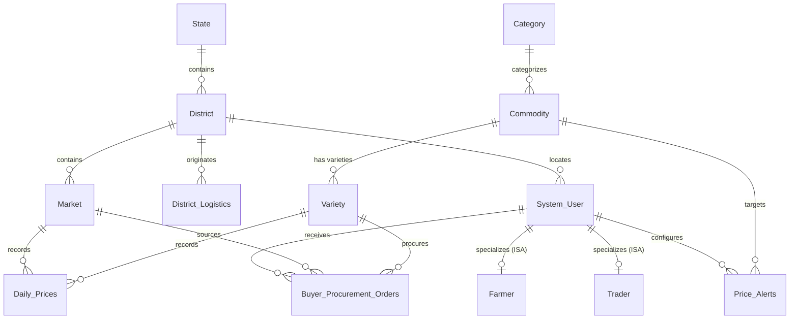

# AgriMarket: Advanced SQL Suite Documentation & Viva Cheat-Sheet
**Database:** `AgriMarket` | **Host:** `localhost:3306` | **Target User:** `root` | **Dialect:** MySQL 8.x / 26.x  
**File Location:** `C:\Users\HP\Documents\sql_mandi\database_and_scripts\sql_features_guide.md`

---

## Table of Contents
1. [Architectural Overview & Schema Map](#1-architectural-overview--schema-map)
2. [Supporting Tables for Buyer Logistics & Automated Orders](#2-supporting-tables-for-buyer-logistics--automated-orders)
3. [Analytical Database Views](#3-analytical-database-views)
4. [Stored Functions (Farmer & Buyer Math Engine)](#4-stored-functions-farmer--buyer-math-engine)
5. [Stored Procedures (Decision Support System)](#5-stored-procedures-decision-support-system)
6. [Automated Real-Time Triggers](#6-automated-real-time-triggers)
7. [The 10 Production Analytical Queries](#7-the-10-production-analytical-queries)
8. [MySQL CLI Terminal Viva Cheat-Sheet](#8-mysql-cli-terminal-viva-cheat-sheet)

---

## 1. Architectural Overview & Schema Map

The `AgriMarket` database provides an enterprise agricultural market data architecture. It normalizes messy raw mandi data from Agmarknet into a 3NF relational schema and layers on an **advanced analytics, risk forecasting, logistics costing, and automated trading engine**.

### Entity-Relationship Architecture


---

## 2. Supporting Tables for Buyer Logistics & Automated Orders

### A. `District_Logistics`
* **Purpose:** Stores transportation distance matrices and freight haulage charges from all agricultural production districts to primary terminal consumption hubs.
* **Schema Definition:**
  ```sql
  CREATE TABLE District_Logistics (
      LogisticsID INT AUTO_INCREMENT PRIMARY KEY,
      OriginDistrictID INT NOT NULL,
      DestHubName VARCHAR(100) NOT NULL,
      DistanceKm DECIMAL(6,2) NOT NULL,
      FreightPerKmQuintal DECIMAL(5,2) DEFAULT 2.50,
      UNIQUE KEY uq_origin_desthub (OriginDistrictID, DestHubName),
      FOREIGN KEY (OriginDistrictID) REFERENCES District(DistrictID) ON DELETE CASCADE
  );
  ```
* **Seed Data:** Populated with realistic highway distances and freight rates for all 13 Maharashtra districts to both:
  1. `Pune (Market Yard Hub)` (Western Maharashtra gateway)
  2. `Mumbai (Vashi Hub)` (India's premier APMC consumption hub)
* **Real-World Use Case (Wholesale Buyers & Aggregators):**  
  A tomato buyer in Mumbai cannot judge mandi prices in isolation. A mandi offering tomatoes at ₹900/Quintal 650 km away in Amravati may be significantly more expensive than one selling at ₹1,100/Quintal 165 km away in Nashik once diesel and logistics are factored in. `District_Logistics` empowers real-time **Landed Cost** calculations.

---

### B. `Buyer_Procurement_Orders`
* **Purpose:** Stores automated purchase orders generated by triggers when commodity prices dip below a buyer's target price threshold.
* **Schema Definition:**
  ```sql
  CREATE TABLE Buyer_Procurement_Orders (
      OrderID INT AUTO_INCREMENT PRIMARY KEY,
      BuyerUserID INT NOT NULL,
      MarketID INT NOT NULL,
      VarietyID INT NOT NULL,
      OrderDate DATE NOT NULL,
      SuggestedQtyTonnes DECIMAL(10,2) NOT NULL,
      TriggeredPrice DECIMAL(10,2) NOT NULL,
      OrderStatus VARCHAR(50) DEFAULT 'AUTO_GENERATED',
      FOREIGN KEY (BuyerUserID) REFERENCES System_User(UserID) ON DELETE CASCADE,
      FOREIGN KEY (MarketID) REFERENCES Market(MarketID) ON DELETE CASCADE,
      FOREIGN KEY (VarietyID) REFERENCES Variety(VarietyID) ON DELETE CASCADE
  );
  ```
* **Real-World Use Case (Retail Chains & Modern Trade):**  
  Modern retail giants (e.g., Reliance Fresh, DMart, BigBasket) deploy automated procurement systems. When mandi arrival gluts cause wholesale apple or onion prices to crash below budget limits, this table captures immediate automated buy intents (25 MT) for dispatch teams.

---

## 3. Analytical Database Views

### View 1: `vw_mandi_complete_feed`
* **Description:** Unified master feed joining 7 relational tables into a single high-performance view.
* **Tables Joined:** `Daily_Prices`, `Market`, `District`, `State`, `Variety`, `Commodity`, `Category`.
* **Output Attributes:**  
  `PriceID`, `RecordDate`, `StateName`, `DistrictName`, `MarketName`, `CategoryName`, `CommodityName`, `VarietyName`, `Grade`, `MinPrice`, `MaxPrice`, `ModalPrice`, `ArrivalTonnes`, `IntradaySpreadPct`.
* **Real-World Use Case:**  
  Powers the primary price-discovery dashboard for farmers and traders. Eliminates complex 7-way table JOINs in backend applications.
* **Terminal Test Command:**
  ```sql
  SELECT * FROM vw_mandi_complete_feed WHERE CommodityName = 'Onion' ORDER BY RecordDate DESC LIMIT 5;
  ```

---

### View 2: `vw_district_crop_summary`
* **Description:** Macro-level aggregation calculating cumulative arrival tonnage, average modal price, peak maximum price, and lowest minimum price grouped by district and commodity.
* **Output Attributes:**  
  `DistrictName`, `CategoryName`, `CommodityName`, `TotalTradingRecords`, `TotalArrivalTonnes`, `AvgModalPrice`, `HighestMaxPrice`, `LowestMinPrice`, `AvgIntradaySpreadPct`.
* **Real-World Use Case (Government Regulators & Agronomists):**  
  Agricultural boards (e.g., MSAMB, APEDA) inspect regional supply bottlenecks. For instance, comparing Nashik onion tonnage (3.3M Tonnes) vs Solapur tonnage (741K Tonnes) reveals market concentration.
* **Terminal Test Command:**
  ```sql
  SELECT * FROM vw_district_crop_summary WHERE CommodityName = 'Tomato' ORDER BY TotalArrivalTonnes DESC;
  ```

---

### View 3: `vw_buyer_mandi_risk_index`
* **Description:** Computes statistical stability, standard deviation (`STDDEV_POP`), and price volatility percentages across mandis with at least 10 trading records.
* **Formulas:**
  $$\text{VolatilityPct} = \frac{\text{STDDEV\_POP}(\text{ModalPrice})}{\text{AVG}(\text{ModalPrice})} \times 100$$
  $$\text{ProcurementRiskRating} = \begin{cases} 
      \text{'HIGH VOLATILITY (RISKY)'} & \text{if VolatilityPct} \ge 25\% \\
      \text{'MODERATE RISK'} & \text{if VolatilityPct} \ge 12\% \\
      \text{'STABLE PRICING (SAFE CONTRACTS)'} & \text{otherwise}
  \end{cases}$$
* **Output Attributes:**  
  `DistrictName`, `MarketName`, `CommodityName`, `TotalTradingDays`, `AvgModalPrice`, `PriceStdDev`, `VolatilityPct`, `AvgIntradaySpreadPct`, `ProcurementRiskRating`.
* **Real-World Use Case (Food Processors & Contract Farming):**  
  Tomato sauce manufacturers (e.g., Kissan, Heinz) avoid sourcing from mandis with `HIGH VOLATILITY (RISKY)` ratings because price swings breach fixed-cost forward contracts.
* **Terminal Test Command:**
  ```sql
  SELECT * FROM vw_buyer_mandi_risk_index WHERE ProcurementRiskRating = 'STABLE PRICING (SAFE CONTRACTS)' LIMIT 5;
  ```

---

## 4. Stored Functions (Farmer & Buyer Math Engine)

| Function Name | Parameters | Returns | Business Math / Logic |
| :--- | :--- | :--- | :--- |
| **`fn_price_spread_pct`** | `min_p DECIMAL(10,2)`, `max_p DECIMAL(10,2)` | `DECIMAL(6,2)` | $\text{LEAST}\left(\frac{\text{Max} - \text{Min}}{\text{Min}} \times 100, 9999.99\right)$. Measures intraday auction price dispersion. |
| **`fn_inflow_status`** | `tonnes DECIMAL(12,2)` | `VARCHAR(30)` | Supply supply tier: $\ge 1000\text{T} \rightarrow \text{'Heavy Glut'}$; $100\text{--}999\text{T} \rightarrow \text{'Moderate Supply'}$; $<100\text{T} \rightarrow \text{'Low Supply'}$. |
| **`fn_calculate_landed_cost`** | `modal_price DECIMAL`, `distance_km DECIMAL`, `freight_rate DECIMAL`, `mandi_cess_pct DECIMAL` | `DECIMAL(10,2)` | $\text{ModalPrice} + (\text{Dist} \times \text{Freight}) + \frac{\text{Modal} \times \text{Cess}}{100}$. Calculates true landed cost in terminal warehouse. |
| **`fn_quality_discount_ratio`** | `variety_modal DECIMAL`, `benchmark_modal DECIMAL` | `DECIMAL(6,2)` | $\frac{\text{VarietyModal} - \text{Benchmark}}{\text{Benchmark}} \times 100$. Computes quality premium (+) or discount (-) vs crop baseline. |

### Terminal Test Commands:
```sql
-- Test 1: Price spread of an auction (Min: 1500, Max: 2100) -> Returns 40.00%
SELECT fn_price_spread_pct(1500.00, 2100.00) AS SpreadPct;

-- Test 2: Inflow status classification -> Returns 'Heavy Glut (>=1000T)'
SELECT fn_inflow_status(1250.00) AS InflowTier;

-- Test 3: Landed cost calculation for 210km at Rs. 2.40/km/Qtl with 1.05% APMC cess
SELECT fn_calculate_landed_cost(2500.00, 210.00, 2.40, 1.05) AS LandedCostPerQtl;

-- Test 4: Variety quality premium (Variety: 2800 vs Benchmark: 2500) -> Returns 12.00%
SELECT fn_quality_discount_ratio(2800.00, 2500.00) AS PremiumPct;
```

---

## 5. Stored Procedures (Decision Support System)

### Procedure 1: `sp_find_best_mandis`
* **Target User:** **Farmers & Farmer Producer Organizations (FPOs)**
* **Input Parameters:**
  - `in_commodity VARCHAR(100)`: Crop to analyze (e.g., `'Onion'`)
  - `in_start_date DATE`: Start of analysis window (e.g., `'2026-01-01'`)
  - `in_end_date DATE`: End of analysis window (e.g., `'2026-10-10'`)
  - `in_limit INT`: Top $N$ mandis to return (default: 10)
* **What it Does:**  
  Aggregates and ranks mandis by highest average `ModalPrice` and peak maximum price. Also surfaces total arrival tonnage so farmers don't get trapped in illiquid mandis.
* **Real-World Value:**  
  A Nashik onion farmer with 10 tractor trolleys checks this procedure before loading to decide whether to drive 40 km further to Dindori or Pimpalgaon for a ₹300/Quintal price bump.
* **Terminal Command:**
  ```sql
  CALL sp_find_best_mandis('Onion', '2026-01-01', '2026-10-10', 5);
  ```

---

### Procedure 2: `sp_buyer_bulk_procurement_plan`
* **Target User:** **Wholesale Buyers, Exporters, Supermarket Chains**
* **Input Parameters:**
  - `in_commodity VARCHAR(100)`: Crop to procure (e.g., `'Tomato'`)
  - `in_required_tonnes DECIMAL(12,2)`: Procurement quota (e.g., `100.00` MT)
  - `in_hub_name VARCHAR(100)`: Target warehouse destination (e.g., `'Mumbai (Vashi Hub)'`)
* **What it Does:**  
  Retrieves the latest available prices for the crop across all mandis, joins with `District_Logistics` for the chosen hub, calculates true **Landed Cost per Quintal** (including 1.05% mandi cess), assesses market supply feasibility (`SUFFICIENT SUPPLY` vs `PARTIAL`), and computes total transaction cost in INR ($1\text{ Tonne} = 10\text{ Quintals}$).
* **Terminal Command:**
  ```sql
  CALL sp_buyer_bulk_procurement_plan('Tomato', 100.00, 'Mumbai (Vashi Hub)');
  ```

---

### Procedure 3: `sp_buyer_arbitrage_radar`
* **Target User:** **Agricultural Traders & Commission Agents**
* **Input Parameters:**
  - `in_commodity VARCHAR(100)`: Crop name (e.g., `'Onion'`)
  - `in_date DATE`: Target trading day (e.g., `'2026-05-15'`)
  - `in_min_margin DECIMAL(10,2)`: Minimum required price spread in ₹/Qtl (e.g., `400.00`)
* **What it Does:**  
  Executes an intra-day self-join on `Daily_Prices` across different districts on the same date, discovering buy-low / sell-high opportunities where $(\text{SellModal} - \text{BuyModal}) \ge \text{in\_min\_margin}$.
* **Real-World Value:**  
  Identifies trade routes like buying Onion in Solapur/Barshi at ₹450/Qtl and selling in Kamthi/Nagpur on the same date at ₹1,770/Qtl (Gross margin: ₹1,320/Qtl or 293% return).
* **Terminal Command:**
  ```sql
  CALL sp_buyer_arbitrage_radar('Onion', '2026-05-15', 400.00);
  ```

---

### Procedure 4: `sp_check_user_alerts`
* **Target User:** **System Users (Farmers and Traders)**
* **Input Parameters:**
  - `in_user_id INT`: Target user ID (e.g., `1` for Farmer Ramesh Patil, `3` for Trader Vikram Joshi)
* **What it Does:**  
  Scans all configured price monitors for that user, compares target prices against the latest recorded market prices across Maharashtra, and flags their status as `TARGET BREACHED` or `MONITORING`.
* **Terminal Command:**
  ```sql
  CALL sp_check_user_alerts(1);
  CALL sp_check_user_alerts(3);
  ```

---

## 6. Automated Real-Time Triggers

### Trigger 1: `trg_after_price_insert_alert`
* **Trigger Event:** `AFTER INSERT ON Daily_Prices FOR EACH ROW`
* **Mechanism:**
  1. Identifies the `CommodityID` from `Variety` via `NEW.VarietyID`.
  2. Updates `Price_Alerts.TriggeredMessage` for all active alerts matching that commodity where:
     - `AlertCondition = 'ABOVE'` AND `NEW.ModalPrice >= TargetPrice`, OR
     - `AlertCondition = 'BELOW'` AND `NEW.ModalPrice <= TargetPrice`.
  3. Formats message: `"ALERT HIT on [RecordDate]: Modal Price reached Rs.[ModalPrice]"`.
* **Real-World Benefit:** Enables instant push/SMS notifications when market prices hit user thresholds.

---

### Trigger 2: `trg_buyer_auto_procurement_order`
* **Trigger Event:** `AFTER INSERT ON Daily_Prices FOR EACH ROW`
* **Mechanism:**
  1. Detects when a new price insert satisfies a Trader's `'BELOW'` alert condition (`NEW.ModalPrice <= TargetPrice`).
  2. Automatically inserts a purchase requisition into `Buyer_Procurement_Orders` with:
     - `BuyerUserID` = Alert owner's UserID
     - `MarketID` = `NEW.MarketID`
     - `VarietyID` = `NEW.VarietyID`
     - `OrderDate` = `NEW.RecordDate`
     - `SuggestedQtyTonnes` = `25.00`
     - `TriggeredPrice` = `NEW.ModalPrice`
     - `OrderStatus` = `'AUTO_GENERATED'`
* **Real-World Benefit:** Algorithmic trade execution; locks in cheap inventory during sudden supply gluts.

---

## 7. The 10 Production Analytical Queries

File: [`real_world_queries.sql`](file:///C:/Users/HP/Documents/sql_mandi/database_and_scripts/real_world_queries.sql)

| Query # | Feature Demonstrated | Real-World Application |
| :---: | :--- | :--- |
| **Q1** | 7-Table Relational Join with Intraday Spread Function | Daily Mandi Price Feed Dashboard for APMC Secretariats |
| **Q2** | `GROUP BY` + `HAVING` (Trading Days $\ge 50$, Vol $\ge 1000$T) | Mandi Liquidity & Volume Ranking for Institutional Buyers |
| **Q3** | Nested Correlated Subquery | Critical Supply Crunch & Speculative Price Spike Detection |
| **Q4** | `YEAR()`, `MONTH()`, `MONTHNAME()` Temporal Aggregations | Multi-Year Crop Harvest Seasonality & Price Cycles |
| **Q5** | EER Subclass Polymorphism (`System_User`, `Farmer`, `Trader`) | Unified Multi-Role User Profile Directory |
| **Q6** | Analytical View Exploration with Risk Rating Filtering | Contract Farming Risk Matrix & Low-Volatility Mandi Selection |
| **Q7** | Stored Functions Suite (All 4 Functions in 1 Query) | Comprehensive Pre-Trade Decision Support Metrics |
| **Q8** | Stored Procedures 1 & 2 Execution | Farmer Mandi Price Maximization & Buyer Bulk Procurement Routing |
| **Q9** | Stored Procedures 3 & 4 Execution | Spatial Inter-District Arbitrage & Live User Alert Auditing |
| **Q10**| Trigger Firing & Automated Order Lifecycle | Algorithmic Limit-Order Simulation & Audit Verification |

---

## 8. MySQL CLI Terminal Viva Cheat-Sheet

Open PowerShell or CMD and launch the MySQL CLI:
```powershell
& "C:\Program Files\MySQL\MySQL Server 26.7\bin\mysql.exe" -u root -psourabh AgriMarket
```

### Ready-to-Paste Viva Demonstration Commands

```sql
-- 1. Check New Supporting Tables
SELECT COUNT(*) AS LogisticsRoutes FROM District_Logistics;
SELECT d.DistrictName, dl.DestHubName, dl.DistanceKm, dl.FreightPerKmQuintal 
FROM District_Logistics dl 
JOIN District d ON dl.OriginDistrictID = d.DistrictID 
LIMIT 4;

-- 2. Demonstrate Analytical Views
SELECT * FROM vw_mandi_complete_feed WHERE CommodityName = 'Tomato' LIMIT 3;
SELECT * FROM vw_district_crop_summary WHERE CommodityName = 'Onion' ORDER BY TotalArrivalTonnes DESC LIMIT 3;
SELECT MarketName, CommodityName, VolatilityPct, ProcurementRiskRating 
FROM vw_buyer_mandi_risk_index 
WHERE ProcurementRiskRating = 'STABLE PRICING (SAFE CONTRACTS)' 
LIMIT 3;

-- 3. Demonstrate Stored Functions
SELECT 
    fn_price_spread_pct(1400.00, 2100.00) AS SpreadPct,
    fn_inflow_status(1500.00) AS SupplyGlutTier,
    fn_calculate_landed_cost(2200.00, 180.00, 2.50, 1.05) AS LandedCostPune,
    fn_quality_discount_ratio(2700.00, 2400.00) AS PremiumPct;

-- 4. Demonstrate Stored Procedures
-- Farmer Best Mandis for Onion
CALL sp_find_best_mandis('Onion', '2026-01-01', '2026-10-10', 3);

-- Buyer Bulk Procurement for Tomato to Mumbai Hub
CALL sp_buyer_bulk_procurement_plan('Tomato', 100.00, 'Mumbai (Vashi Hub)');

-- Trader Inter-District Arbitrage Radar for Onion
CALL sp_buyer_arbitrage_radar('Onion', '2026-05-15', 500.00);

-- User Alert Status for Farmer (User 1) and Trader (User 3)
CALL sp_check_user_alerts(1);
CALL sp_check_user_alerts(3);

-- 5. Demonstrate Triggers in Real-Time
-- Step A: Check alert condition before trigger
SELECT AlertID, CommodityID, TargetPrice, AlertCondition, TriggeredMessage FROM Price_Alerts WHERE AlertID = 3;

-- Step B: Insert daily price that dips below target (Apple <= 8000.00)
INSERT INTO Daily_Prices (MarketID, VarietyID, Grade, RecordDate, MinPrice, MaxPrice, ModalPrice, ArrivalTonnes)
VALUES (1, 1, 'Viva-Demo', '2026-10-20', 6500.00, 7500.00, 7000.00, 25.00);

-- Step C: Verify Trigger 1 updated alert message
SELECT AlertID, TriggeredMessage FROM Price_Alerts WHERE AlertID = 3;

-- Step D: Verify Trigger 2 created auto procurement order
SELECT * FROM Buyer_Procurement_Orders WHERE TriggeredPrice = 7000.00;

-- Step E: Clean up demo rows
DELETE FROM Daily_Prices WHERE Grade = 'Viva-Demo';
DELETE FROM Buyer_Procurement_Orders WHERE TriggeredPrice = 7000.00;
```
